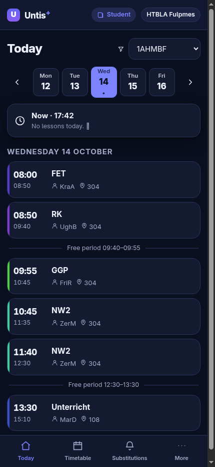
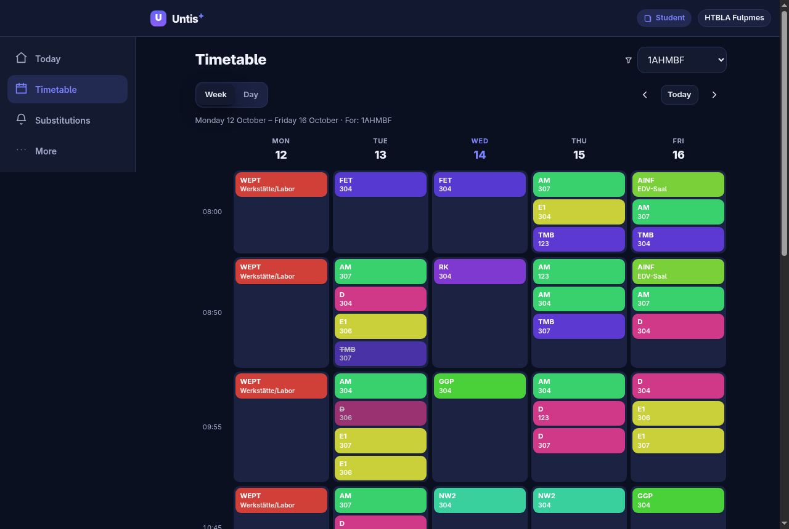
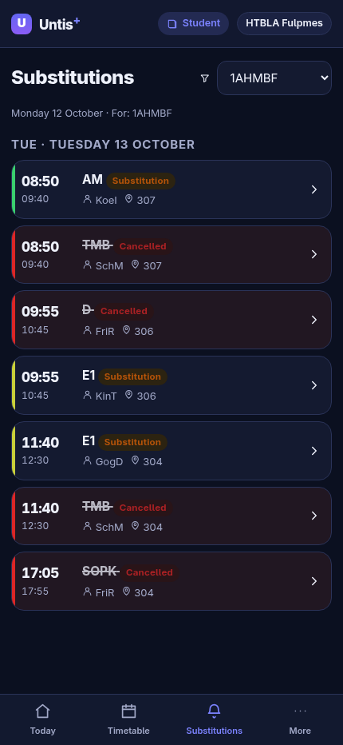
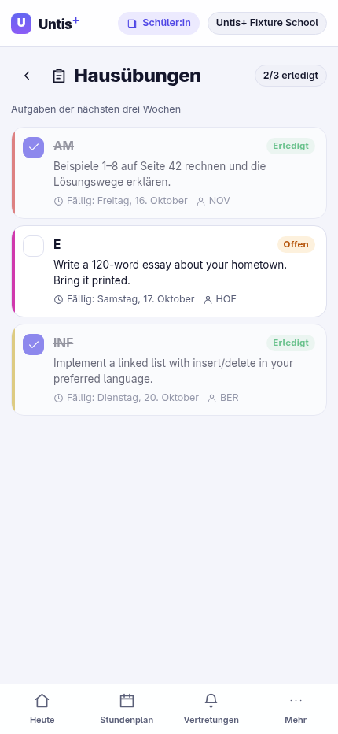
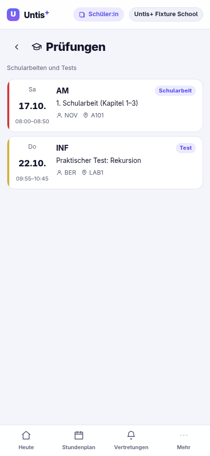
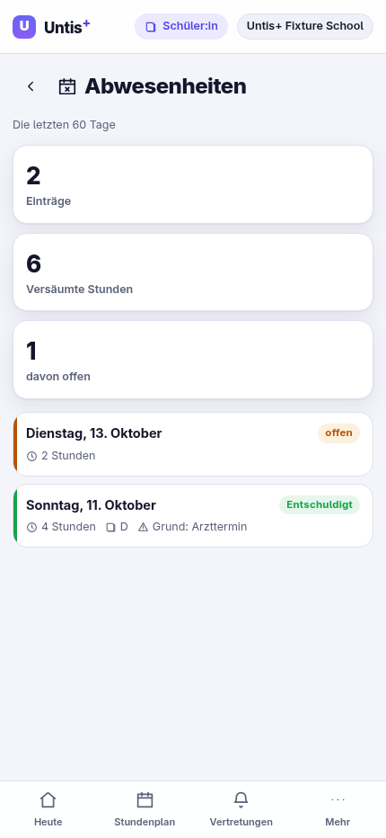
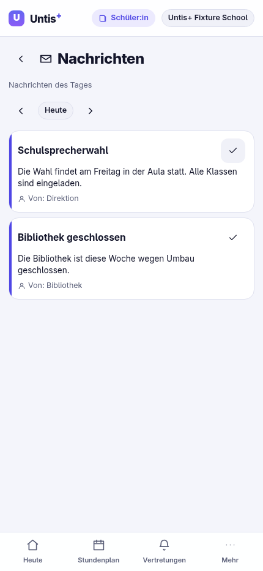
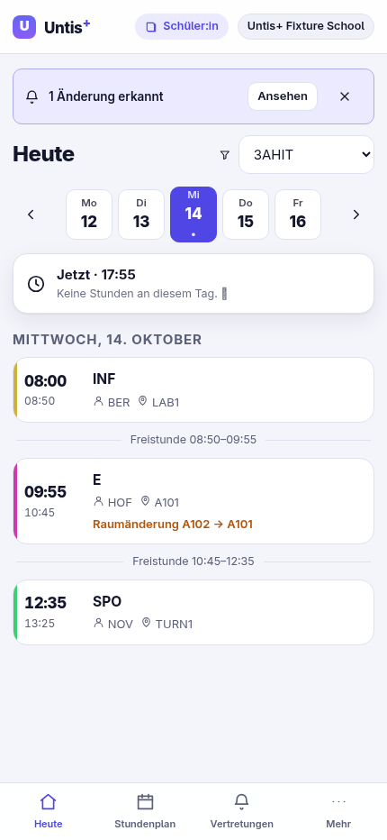

# Untis⁺ — a better WebUntis

An installable web app (PWA) plus a small server proxy that reads **real** WebUntis data and
presents it better — for **students and teachers** alike. German first, English one tap away.

> Untis⁺ is an independent client and is **not affiliated with Untis GmbH**.

---

## Why

WebUntis works, but people miss changes: substitutions are confusing, push notifications only
cover *new messages* (not the substitutions that actually affect you), the app is heavy and
sometimes crashes, and 2FA accounts can't easily use the API. Untis⁺ fixes the daily experience:

- a clean **day view** with free periods and a persistent **“now / next”** bar,
- a **week grid** that stays readable on a phone,
- a **substitution list** derived from the timetable (cancellations + changes, with the reason),
- **before → after** detail on every changed lesson,
- a **change watcher** that snapshots your week and alerts you (in-app + browser notification) the
  moment a lesson is cancelled, moved or re-roomed — so you never miss a substitution,
- **homework, exams, absences and messages** in one hub, with local completion/read tracking,
- the **same app, role-aware** for teachers (classes instead of teachers, “my timetable” by default),
- offline-friendly and installable (PWA), with **light/dark** themes and **de/en** i18n from day one.

---

## Status

| Phase | Area | State |
| --- | --- | --- |
| 0 | Monorepo, shared types, WebUntis client, API, tests | ✅ done |
| 1 | Web app shell, onboarding, Today, Timetable, Substitutions, Settings | ✅ done |
| 2 | Substitution derivation, i18n (de/en), themes, PWA, offline cache | ✅ done |
| 3 | Homework, exams, absences, messages (module hub) | ✅ done |
| 4 | Change watcher: substitution detection + Web Notifications | ✅ done |
| 5 | Accounts/persistence, multi-school, grades/PDF, deployment | ⏳ next |

Verified end-to-end against **live** public WebUntis data (anonymous sign-in, no account):
school search → login → master data → timetable → substitutions, plus a mocked-upstream test
suite for the client.

---

## Screenshots

| Today (mobile, dark) | Timetable (desktop, dark) | Substitutions (mobile, dark) |
| --- | --- | --- |
|  |  |  |

| Homework | Exams | Absences | Messages |
| --- | --- | --- | --- |
|  |  |  |  |

| Change watcher (a substitution was detected) |
| --- |
|  |

---

## Repository layout

```
untisplus/
├─ apps/
│  ├─ api/                 # Fastify + TypeScript proxy and WebUntis client
│  │  └─ src/
│  │     ├─ index.ts       # server entry
│  │     ├─ server.ts      # routes, cookie sessions, error mapping
│  │     ├─ sessions.ts    # in-memory session store + re-auth
│  │     ├─ cache.ts       # tiny TTL cache for upstream reads
│  │     ├─ fixtures.ts    # offline demo data (FIXTURES=1)
│  │     └─ untis/
│  │        ├─ client.ts   # zero-dependency WebUntis client (anon/password/secret)
│  │        ├─ discovery.ts# school search (mobile.webuntis.com/ms/schoolquery2)
│  │        ├─ normalize.ts# raw WebUntis → domain model
│  │        └─ totp.ts     # RFC 6238 TOTP (+ the fixed anonymous OTP)
│  └─ web/                 # React + Vite + TS PWA
│     ├─ public/
│     │  └─ mods/          # bundled example mods (theme-pack, hello-page, compact, sticker)
│     └─ src/
│        ├─ main.tsx, App.tsx, store.tsx, router.ts
│        ├─ api.ts, data.ts, hooks.ts, lib.ts, i18n.ts, styles.css
│        ├─ themes.ts      # theme registry, apply/persist, share encode/decode
│        ├─ themes/        # built-in theme definitions
│        ├─ mods.ts        # mod runtime + window.UntisPlus (ModApi)
│        ├─ components/    # AppShell, LessonCard, NowBar, TargetPicker, ModHost, primitives
│        └─ views/         # Onboarding, Today, TimetableView, Substitutions, Appearance, Mods, Settings
├─ packages/
│  └─ shared/              # shared domain types, dates, theme model, mod API types
├─ docs/
│  └─ tutorials/           # themes & mods guides (install + author) and API reference
├─ OVERVIEW.md             # research, API reality, problem inventory, architecture
└─ BUILD-MEGA-PROMPT.md    # executable phased build prompt
```

---

## Quick start

Requirements: **Node ≥ 20**.

```bash
npm install

# terminal 1 — API proxy (http://localhost:8787)
npm run dev:api

# terminal 2 — web app (http://localhost:5173, proxies /api to the API)
npm run dev:web
```

Open <http://localhost:5173>. Search for a school, pick **“Ohne Konto / No account”**, and sign in.

### Run without any WebUntis access

Start the API with fixtures and the app serves canned data for a demo school:

```bash
FIXTURES=1 npm run dev:api
```

The onboarding screen then offers a **“Demo school”** shortcut.

---

## How the data works

WebUntis exposes several surfaces; this project uses the ones that actually work today:

- **School search** — `POST https://mobile.webuntis.com/ms/schoolquery2` (`method: searchSchool`).
- **Anonymous sign-in** — the internal endpoint
  `/WebUntis/jsonrpc_intern.do?m=getUserData2017` with `user: "#anonymous#"` and the fixed
  OTP `100170`. It returns the full **master data** (classes, teachers, subjects, rooms,
  holidays, time grid) and a `JSESSIONID` cookie. This is the zero-setup path for students.
- **Timetable** — `getTimetable` with *options-style* params (so names come back, not just ids).
- **Password / app-secret (2FA)** — classic `jsonrpc.do` `authenticate`, or the same intern
  endpoint with a TOTP generated from the QR secret.

The browser **never** sees a WebUntis credential or the upstream session id — it gets an opaque
cookie that maps to a server-side client. Secrets stay on the server, and sessions renew
transparently (including anonymous ones, which expire every few minutes).

### Substitutions without the substitution API

Public/anonymous access is sometimes denied `getSubstitutions()`. Untis⁺ therefore also derives
substitutions from the **timetable itself**: changed lessons carry a `code` (`cancelled` /
`irregular`) and often a `substText` / `info`. The Substitutions view reads those directly, so it
works even where the dedicated endpoint is forbidden.

### Time encoding gotcha

WebUntis packs times as `HMM` integers (`1330` → 13:30, `800` → 08:00), **not** minutes since
midnight; the master-data time grid uses `"T07:10"` strings. Conversion lives in
`packages/shared/src/dates.ts` and is covered by tests.

---

## API endpoints

The proxy exposes a small, stable surface under `/api`:

| Method | Path | Purpose |
| --- | --- | --- |
| `GET` | `/health` | liveness + whether fixtures are on |
| `GET` | `/schools?q=` | school search |
| `POST` | `/session` | sign in (`anonymous` \| `password` \| `secret`) |
| `GET` | `/session` | current session summary |
| `DELETE` | `/session` | sign out |
| `GET` | `/master` | master data |
| `GET` | `/timetable?start=&end=&targetType=&targetId=` | normalized lessons |
| `GET` | `/substitutions`, `/homework`, `/absences`, `/exams`, `/messages` | modules (graceful `{available:false}` when the session lacks permission) |

Errors are mapped to clear codes: `auth_failed`, `permission_denied`, `session_expired`,
`school_search_failed`, `upstream_error`.

### Modules & permissions

Public (anonymous) sessions at many schools may read only the timetable. Untis⁺ therefore treats a
module as *unavailable* — not as a failure — when WebUntis answers with a permission error
(`-8509`/`-8510`) or "method not found" (`-32601`). The UI shows a friendly notice instead of an
error screen, and the very same endpoints return real data once you sign in with an account that
has the matching role. Homework, exams, absences and messages each carry a small local-state layer
(done / read) because the public API is read-only.

---

## Themes & mods

Untis⁺ is a **platform**, not a fixed look: anyone can restyle or extend it without touching the
source.

- **Themes are data.** A theme is a JSON object of design tokens (colors, radii, font). Pick a
  bundled theme, clone and tweak it in the built-in editor (with a live **WCAG contrast meter**),
  import/export a file, or share it as a link. Unknown tokens are dropped, so a theme can never
  break the app.
- **Mods are code.** A mod is a small ES module that talks to the app through one global,
  `window.UntisPlus`. Mods can add pages and nav items, inject CSS, register themes, reshape the
  timetable/substitutions (pure transforms), add settings, translations and commands, keep
  namespaced storage, and subscribe to app events. A mod that throws is caught, rolled back and
  listed with its error on the **Mods** screen — the app keeps working.
- **Offline by default.** Themes and mods are stored locally (`localStorage`) and applied before
  first paint; the bundled examples ship in `apps/web/public/mods/`.

Open **More → Customize** for **Appearance** (`#/appearance`) and **Mods** (`#/mods`). Try the
bundled example mods (off by default): *Extra themes*, *Hello page*, *Compact lessons*, *Sticker*.

### Tutorials

- [Themes & mods overview](docs/tutorials/README.md)
- [Install & use a theme](docs/tutorials/install-a-theme.md) · [Make a theme](docs/tutorials/making-a-theme.md)
- [Install & manage mods](docs/tutorials/install-a-mod.md) · [Make a mod](docs/tutorials/making-a-mod.md)
- [Mod API reference (v1)](docs/tutorials/mod-api.md) · [Recipes](docs/tutorials/recipes.md)

---

## Testing

```bash
npm run typecheck     # all workspaces
npm test              # all workspaces
npm run build         # typecheck + production build (web emits the PWA)
```

- `packages/shared` — date/time + HMM conversions.
- `apps/api` — TOTP (RFC 6238 vectors), normalizers (real lesson shapes), the WebUntis client
  (mocked upstream incl. **anonymous re-auth** and permission mapping), and the Fastify server
  in fixtures mode.

---

## Configuration

| Variable | Where | Default | Meaning |
| --- | --- | --- | --- |
| `PORT` / `HOST` | API | `8787` / `0.0.0.0` | listen address |
| `FIXTURES` | API | off | serve canned data, no upstream calls |
| `API_URL` | Web (vite) | `http://localhost:8787` | API target for the dev/preview proxy |

---

## What's next

- Background notifications via the Periodic Background Sync API (currently the watcher runs while
  the app is open / on focus).
- Grades/points, PDF reports, and message attachments.
- Multiple saved sessions / schools and server-side persistence.
- Deployment guidance (single-origin: serve the built `apps/web/dist` behind the API).

See [`OVERVIEW.md`](OVERVIEW.md) for the full problem inventory, architecture, and roadmap, and
[`BUILD-MEGA-PROMPT.md`](BUILD-MEGA-PROMPT.md) for the phased build prompt.
