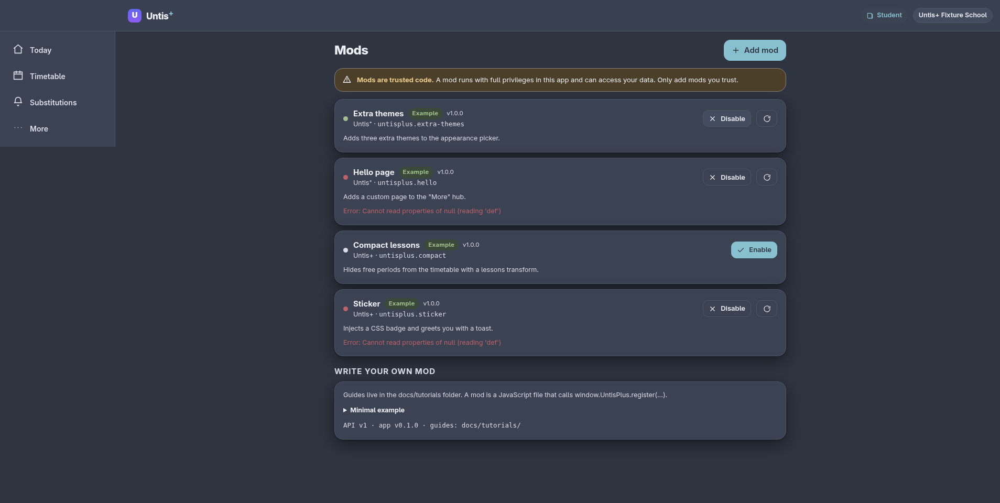

# Install & manage mods

A **mod** is a small JavaScript add-on. It can add pages, change how the timetable looks, inject
styling, add settings and translations, and more.



> ⚠️ **Mods are trusted code.** Untis⁺ runs them with full app privileges; there is no sandbox.
> A mod can read anything the app can read. Only add mods you trust — ideally ones whose source
> you can see. If a mod misbehaves, the app protects itself by catching the error (see below).

## Open the Mods screen

Go to **More → Customize → Mods**, or directly to `#/mods`.

At the top you'll see a list of mods. Each row shows its **name**, **author/id**, a short
**description**, and its **state**:

| State | Meaning |
| --- | --- |
| **Enable** button | Installed but off. |
| **Disable** + **Reload** | On and running. **Reload** re-runs it (useful after an update). |
| Red **Error** text | It failed to load; the app kept running. |
| **Remove** | Only user-added mods can be removed; bundled examples can't. |

The bundled **example mods** are off by default — try them to see what's possible:

- **Extra themes** — adds three themes to the Appearance picker.
- **Hello page** — adds a “Hello” page to the More hub, plus a settings section and a command.
- **Compact lessons** — hides free periods from the timetable.
- **Sticker** — injects a small CSS badge and greets you with a toast.

## Add a mod

Tap **Add mod**, then choose one of two sources.

### From a URL (recommended for shared mods)

Paste a link to a `.js` file, give it a name, and tap **Add mod**.

```
https://example.com/untisplus/my-mod.js
```

Requirements for the host:

- The file must be served as `text/javascript` (or `application/javascript`).
- It must allow **CORS** from the app's origin (a permissive `Access-Control-Allow-Origin`),
  because the module is loaded by the browser.
- It should call `UntisPlus.register({ ... })` (see [making-a-mod.md](making-a-mod.md)).

> Tip: a raw file URL from a code host works if it serves `text/javascript` with permissive
> CORS. When in doubt, host the `.js` on any static host (GitHub Pages, Netlify, S3, …).

## From code

Choose **From code** and paste the whole module. It's stored locally on this device. Great for
testing, or for a mod you wrote yourself.

```js
UntisPlus.register({
  id: 'com.example.tidy',
  name: 'Tidy',
  apiVersion: 1,
  setup(api) {
    api.css.add('.appbar { backdrop-filter: blur(6px); }');
  },
});
```

Give it a **Name**, tap **Add mod**, and it's enabled immediately.

## When a mod fails

Untis⁺ never shows you a blank screen because of a mod:

1. The error is caught.
2. The mod is listed with a red **Error** line showing the message.
3. The app keeps working; anything the mod already registered is cleaned up.

Fix the mod (or its URL) and press **Enable**/**Reload**, or **Remove** it. If the whole app
somehow misbehaves, removing the mod from this screen — or clearing site data — restores it.

## Where mods are stored

Mods and their on/off state live in your browser's `localStorage`, so they persist across
reloads and work offline. A mod that was added by URL is **not** re-downloaded in the
background; it loads when the app starts (and when you press Reload).

## Safety checklist

- [ ] Do you trust the source of this mod?
- [ ] Can you read its code (or is it from a project you trust)?
- [ ] Does it ask for anything surprising (network calls to unknown hosts, etc.)?

If the answer to any of these is "no", don't install it.

Next: [write your own mod](making-a-mod.md) or browse the [API reference](mod-api.md).
