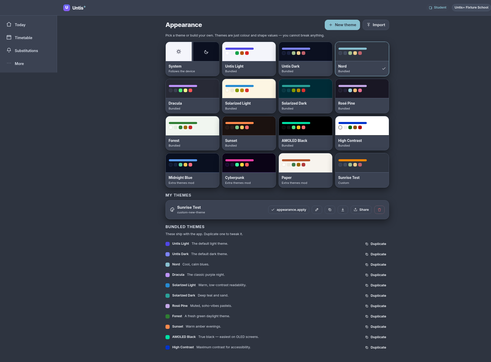

# Install & use a theme

A theme changes the colors, corner rounding and font of Untis⁺. You never have to write code.

## Choose a bundled theme

1. Open **More → Customize → Appearance** (or go directly to `#/appearance`).
2. Tap any card in the grid. It applies **instantly** and is remembered on this device.

**System** follows your device's light/dark setting and switches automatically. Every other
card is a fixed look.

## Make your own in 30 seconds

1. On **Appearance**, tap **New theme**.
2. Change anything: type a **hex color**, use the **color picker**, adjust the **radii**, or set
   a **font stack**.
3. Watch the **Contrast (WCAG)** meter. Keep at least **AA** on “Text on background” and
   “Text on surface” so the app stays readable.
4. Give it a **Name**, pick **Light** or **Dark**, and tap **Save**.

A quick way to start from something you like: find a bundled card, tap **Duplicate**, then
tweak it.

## Import a theme someone shared

You have two options:

- **From a file** — On **Appearance**, tap **Import**, then choose the `.json` file.
- **From a link** — If someone sends you an Untis⁺ theme link (it ends in
  `#/appearance?theme=…`), just open it. The theme is previewed and offered for saving.

Imports are validated: a broken or malicious file cannot crash the app. If the file isn't a
theme, you'll see a toast saying so.

## Share a theme you made

1. Open the theme in the editor (**Edit** on your card).
2. Tap **Share** — the theme is copied to your clipboard as a **link**.
3. Paste it in a chat. Whoever opens it gets the same one-tap preview/save flow.

You can also tap **Export** to download a `.json` file — handy for backups or attaching to a
message.

## Manage your themes

Your own themes appear under **My themes**. Each has:

- **Edit** — reopen the editor,
- **Duplicate** — make a variant,
- **Export** / **Share** — hand it out,
- **Delete** — remove it (bundled themes can't be deleted).

The currently active theme is shown with a highlighted card. Switching back to **System**
restores automatic light/dark.

## Troubleshooting

- **The theme didn't apply.** Reload once. If it still doesn't, the stored value may be from an
  older version — open **Appearance** and pick a card again.
- **Text is hard to read.** Open the editor and check the contrast meter; nudge `text`, `bg`
  or `surface` until the rows show **AA** or better.
- **I want the look but not the code.** Use **Share**/**Export** — that's just data.

Next: [make a theme from scratch (with code)](making-a-theme.md) or
[install a mod](install-a-mod.md).
