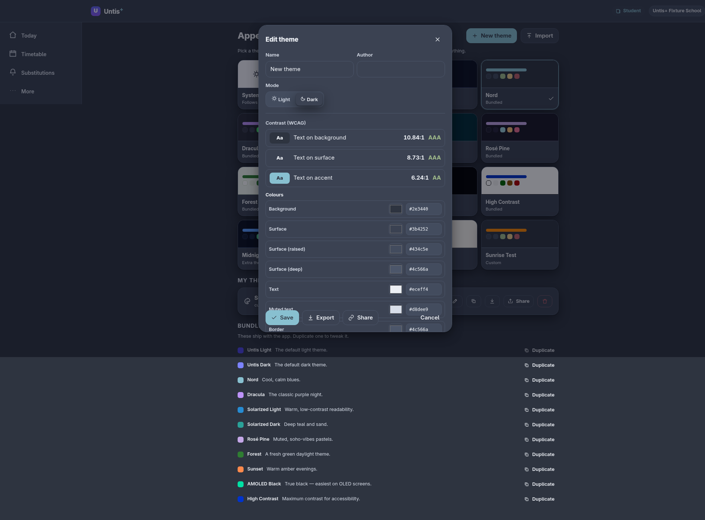

# Make a theme

A theme is **data**: a JSON object of design tokens plus a light/dark mode. You can author one
by hand, ship it as a file, share it as a link, or register it from a mod.



## The format

```json
{
  "id": "nord-bright",
  "name": "Nord (bright)",
  "mode": "light",
  "author": "you",
  "description": "A lighter take on Nord.",
  "tokens": {
    "bg": "#eceff4",
    "surface": "#ffffff",
    "text": "#2e3440",
    "accent": "#5e81ac",
    "accent-ink": "#ffffff"
  }
}
```

| Field | Required | Notes |
| --- | --- | --- |
| `id` | no | Unique slug. If missing, one is derived from `name`. |
| `name` | **yes** | Shown on the card. |
| `mode` | no | `"light"` or `"dark"` (default `"dark"`). Sets the base text/scrollbar scheme. |
| `author` | no | Shown in the editor. |
| `description` | no | One-line blurb on the card. |
| `tokens` | **yes** | Map of token → CSS value. Partial is fine; the rest falls back. |
| `css` | no | Extra raw CSS applied while this theme is active (advanced; see below). |

Only known token keys are kept. A typo is **ignored**, not an error — your theme simply won't
override that one variable.

## Token reference

Tokens map 1:1 to CSS custom properties, but written **without** the leading `--`.

### Colors (`kind: color`)

| Token | Meaning |
| --- | --- |
| `bg` | App background |
| `surface` | Cards and panels |
| `surface-2` | Raised surfaces (menus, chips) |
| `surface-3` | Deep surfaces (inputs, wells) |
| `text` | Primary text |
| `muted` | Secondary text |
| `border` | Dividers and outlines |
| `accent` | Brand / primary action color |
| `accent-ink` | Text **on** `accent` |
| `accent-soft` | Tinted accent background |
| `ok` / `ok-soft` | Success text / background |
| `warn` / `warn-soft` | Warning text / background |
| `danger` / `danger-soft` | Error text / background |

### Shape (`kind: length`)

| Token | Meaning |
| --- | --- |
| `radius` | Default corner radius (e.g. `12px`) |
| `radius-sm` | Small radius (chips, tags) |
| `radius-lg` | Large radius (sheets, modals) |

### Type (`kind: font`)

| Token | Meaning |
| --- | --- |
| `font` | Font-family stack, e.g. `"Inter", system-ui, sans-serif` |

> Values are CSS values, so `bg` can be `#2e3440`, `rgb(46 52 64)`, `hsl(220 16% 22%)`, or even
> a gradient where gradients are allowed. Colors used by the contrast meter should be
> parseable colors (hex / `rgb()` / `hsl()`).

## Authoring rule of thumb

1. Start from an existing theme (**Duplicate** in the app) and change a few tokens.
2. Keep `text` on `bg` and on `surface` at **WCAG AA** contrast or better. The editor's meter
   tells you the ratio in real time.
3. Make sure `accent-ink` contrasts with `accent` — that pair is used on buttons and badges.

## Ship it as a file

Save your JSON as `mytheme.json`. Users open **Appearance → Import** and pick the file.

Validate locally if you like — the same rules the app applies are available from the shared
package:

```ts
import { parseTheme, serializeTheme, contrastRatio, wcagLevel } from '@untisplus/shared';

const theme = parseTheme(myJsonString); // throws ThemeError if unusable
console.log(contrastRatio(theme.tokens.text, theme.tokens.bg)); // e.g. 10.84
console.log(wcagLevel(10.84)); // 'AAA'
console.log(serializeTheme(theme)); // pretty JSON for export
```

## Ship it as a link

The app can encode a theme into the URL fragment, so a link is a complete install:

```
https://your-untisplus-host/#/appearance?theme=<encoded-json>
```

The encoder (used by the app's **Share** button) lives in `apps/web/src/themes.ts`
(`encodeThemeLink` / `decodeThemeParam`). If you're generating links yourself, base64-encode
the JSON, then URL-encode it.

## Ship it inside a mod (advanced)

A mod can register one or more themes. This is how the bundled **Extra themes** example works.

```js
UntisPlus.register({
  id: 'com.example.my-themes',
  name: 'My theme pack',
  apiVersion: 1,
  setup(api) {
    api.themes.register({
      id: 'midnight-blue',
      name: 'Midnight Blue',
      mode: 'dark',
      description: 'Deep blue night.',
      tokens: {
        bg: '#0b1020',
        surface: '#141a2e',
        text: '#e6e9f5',
        muted: '#9aa3c0',
        accent: '#5b8cff',
        'accent-ink': '#0b1020',
        border: '#243056',
      },
    });
  },
});
```

Mod-registered themes appear in the same picker as bundled ones and disappear again if the mod
is disabled.

## The `css` escape hatch

For looks that need more than tokens (background textures, unusual shadows), include a `css`
string. It is injected only while the theme is active.

```json
{
  "id": "blueprint",
  "name": "Blueprint",
  "mode": "dark",
  "tokens": { "bg": "#0a1a33", "text": "#cfe3ff", "accent": "#57b6ff" },
  "css": "body { background-image: linear-gradient(#0a1a3333 1px, transparent 1px), linear-gradient(90deg, #0a1a3333 1px, transparent 1px); background-size: 24px 24px; }"
}
```

`css` is trusted code from the theme author (same trust model as mods). Prefer tokens when you
can — they're previewed and validated.

## Checklist before sharing

- [ ] Has a unique `id` and a human `name`.
- [ ] `mode` matches the overall lightness.
- [ ] `text`/`bg` and `text`/`surface` pass **AA**.
- [ ] `accent-ink`/`accent` passes **AA**.
- [ ] Tested both a light and dark base device setting (System) with your theme selected.

Next: [install a mod](install-a-mod.md).
